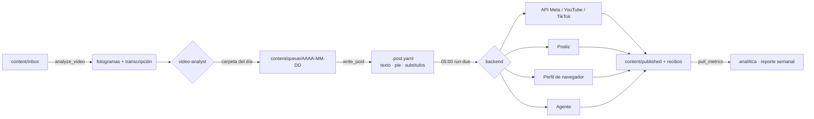

<a id="top"></a>

<div align="center">

<picture>
  <source media="(prefers-color-scheme: dark)" srcset="assets/readme/banner-es-dark.svg">
  
</picture>

<br/>

[](https://github.com/robgallardof/social-publisher-mcp/actions/workflows/tests.yml)


[English](README.md) · **Español**

</div>

<p align="center">
<a href="#-qué-hace"></a>
<a href="#-funciona-con-cualquier-agente"></a>
<a href="#-inicio-rápido"></a>
<a href="#-el-camino-de-un-video"></a>
<a href="#-herramientas-mcp-15"></a>
<a href="#-roles-y-skills"></a>
<a href="#-formas-de-publicar"></a>
<a href="#-estructura"></a>
<a href="#-desarrollo"></a>
<a href="#-bueno-saber"></a>
</p>

<a id="-qué-hace"></a>
##  Qué hace

| | |
|---|---|
|  **Cola por fecha** | `content/queue/2026-10-27/*.mp4` sale el 27 de octubre. Tres videos en la carpeta = tres publicaciones a las 05:00. Las carpetas de semana (`2026-W44/`) se reparten solas entre los días. |
|  **Ve cada video** | Hoja de 8 fotogramas + transcripción (faster-whisper) → sabe qué pasa, si hay voz y si ya trae subtítulos. |
|  **Texto por red** | Gancho, cuerpo, llamada a la acción, hashtags y palabras clave para TikTok, Instagram Reels, Facebook Reels y YouTube Shorts, validados contra los límites reales de cada una. |
|  **Pie de redes** | Cada descripción termina con `📲 Síguenos también:` y tus usuarios en las *otras* redes, automático. |
|  **Subtítulos** | Decide: ninguno / automáticos de la plataforma / `.srt` / quemados en el video, y los renderiza con estilo para vertical. |
|  **Publica como sea** | APIs oficiales (Meta, YouTube, TikTok) → Postiz → perfil de navegador con Playwright → el propio agente (Claude in Chrome, Playwright MCP, computer use). |
| ⏰ **05:00 todos los días** | Tarea programada de Windows (cron en macOS/Linux): publicador idempotente con reintentos; despierta la PC y se pone al día si estuvo apagada. |
|  **Aprende** | Saca métricas, mejores días, videos top y bottom, y un reporte semanal con máximo tres acciones. |

<a id="-inicio-rápido"></a>
##  Inicio rápido

<p align="center"><picture><source media="(prefers-color-scheme: dark)" srcset="assets/readme/diagrams/publishing-es-dark.svg" /></picture></p>


```powershell
git clone https://github.com/robgallardof/social-publisher-mcp.git
cd social-publisher-mcp
powershell -NoProfile -ExecutionPolicy Bypass -File scripts/bootstrap.ps1        # entorno, pruebas, configs, MCP
powershell -NoProfile -ExecutionPolicy Bypass -File scripts/install-schedule.ps1 # tarea diaria de las 05:00
```

macOS / Linux: `sh scripts/bootstrap.sh` y la línea de cron que imprime al final. Requiere [uv](https://docs.astral.sh/uv/).

**¿Prefieres Docker?** Es opcional: la imagen solo lleva el código del MCP y tu carpeta se monta al ejecutarla.

```bash
docker build -t social-forge:local .
docker run --rm -i -v "C:/ruta/a/social-publisher-mcp:/workspace" social-forge:local      # stdio, para clientes MCP
export SOCIAL_FORGE_MCP_TOKEN="$(python -c 'import secrets; print(secrets.token_hex(32))')"
export SOCIAL_FORGE_PORT=8766
docker compose up -d --build --wait social-forge   # HTTP con token
```

Puertos, extras (`analysis`), el servicio de CLI y cómo programar `run-due` desde tu PC: [docs/DOCKER.md](docs/DOCKER.md) (en inglés).

Luego háblale a tu agente:

> *"Procesa el inbox"* · *"Prepara lo de mañana"* · *"Reparte la semana 44, dos por día"* · *"Ponle subtítulos al storytime"* · *"¿Qué funcionó esta semana?"* · *"Investiga tendencias de ardillas en México"*

### Conecta tu agente

Elige OpenCode o DeepSeek Harness para trabajar con este servidor desde tu agente. Primero revisa los cambios; después aplica la configuración.

```sh
python scripts/install-mcp.py --clients opencode --dry-run
python scripts/install-mcp.py --clients opencode
opencode mcp list
```

<details>
<summary>Usar DeepSeek Harness en su lugar</summary>

```sh
python scripts/install-mcp.py --clients deepseek --dry-run
python scripts/install-mcp.py --clients deepseek
dsh web --patch .dsh/mcp.cordis.yml
```

</details>

[Configuración, retirada y versiones comprobadas](scripts/CLIENTS.md).

<a id="-funciona-con-cualquier-agente"></a>
##  Funciona con cualquier agente

`social-forge` es un **servidor MCP stdio** estándar. Además de sus herramientas expone cada **skill como recurso MCP** (`skill://<nombre>`) y cada **rol como prompt MCP**, así cualquier cliente MCP recibe el manual completo, no solo los que leen `.agents/`.

| Cliente | Cómo |
|---|---|
| Claude Code | `.mcp.json` en la carpeta, o para tu usuario con el instalador (+ skills/agentes enlazados en `~/.claude`) |
| Codex | `.codex/config.toml` / `~/.codex/config.toml` |
| Antigravity | `.agents/mcp_config.json` / `~/.gemini/antigravity/mcp_config.json` |
| Cursor · VS Code · Gemini CLI · Windsurf · Claude Desktop | configs generadas, o el instalador |

```powershell
python scripts/install-mcp.py --list         # qué clientes tienes
python scripts/install-mcp.py --with-skills  # lo registra para tu usuario en todos (respaldo .bak de cada archivo)
python scripts/install-mcp.py --remove       # deshacer
python scripts/install-mcp.py --workspace ../davinci-agents  # cualquier otro workspace con config/mcp.servers.json
```

<a id="-el-camino-de-un-video"></a>
##  El camino de un video

<details>
<summary>Diagrama técnico</summary>



</details>

<a id="-roles-y-skills"></a>
##  Roles y skills

**Roles** (`.agents/agents/`): `community-manager` (líder) · `video-analyst` · `content-strategist` · `copywriter` · `publisher` · `audience-analyst` · `trend-researcher`

**Skills** (`.agents/skills/`): `content-queue` · `video-analysis` · `subtitles` · `platform-copywriting` · `social-publishing` (+ guía por red) · `agent-browser-upload` · `content-strategy` · `audience-analytics` · `trend-research` · `community-engagement`

El rol líder **pregunta antes de escribir**: tus usuarios en cada red, @menciones, links, hashtags fijos y preferencia de subtítulos.

<a id="-herramientas-mcp-15"></a>
##  Herramientas MCP (15)

| Herramienta | |
|---|---|
| `queue_status` | Qué sale cada día, atrasados, sin texto, videos nuevos en el inbox |
| `plan_week` | Reparte una carpeta de semana en sus días restantes |
| `analyze_video` | Fotogramas, transcripción, voz sí/no, `.srt` |
| `make_subtitles` | `.srt` y, si quieres, una copia con subtítulos quemados para revisar |
| `check_video` | Duración/resolución contra cada plataforma |
| `write_post` · `preview_post` | Guardar y previsualizar el texto por red (el pie se agrega solo) |
| `brand_info` | Usuarios por red y cuáles faltan |
| `publish_due` · `publish_now` | Publicar o programar (siempre `dry_run` primero) |
| `mark_published` | Cerrar una subida hecha por el agente o a mano |
| `backends_status` | ¿Cada red está lista? |
| `platform_rules` | Límites por plataforma |
| `pull_metrics` · `insights_report` | Métricas y resumen |

<a id="-formas-de-publicar"></a>
##  Formas de publicar

| Backend | Redes | ¿Público de inmediato? | ¿Programa solo? |
|---|---|---|---|
| `meta_api` | Instagram, Facebook |  | Facebook  |
| `youtube_api` | YouTube | tras la auditoría de Google |  `publishAt` |
| `tiktok_api` | TikTok | tras la auditoría de TikTok | — |
| `postiz` | todas |  |  (la PC puede estar apagada) |
| `browser` | todas |  | — |
| `handoff` | todas | lo hace el agente | — |

Credenciales: [`docs/accounts.md`](docs/accounts.md). Viven en `secrets/` (ignorado por git).

<a id="-estructura"></a>
##  Estructura

```
content/inbox/        suelta aquí los videos nuevos
content/queue/        AAAA-MM-DD/ (o AAAA-Www/) + <video>.post.yaml
content/published/    archivo con recibos          content/library/  tomas crudas, versiones renderizadas
brand/                voz, audiencia, hashtags     config/           social.yaml, flujos de navegador, servidores MCP
mcp/social-forge/     el MCP + CLI (domain → services → app → server/cli)
Dockerfile, compose.yaml   imagen opcional (stdio o HTTP con token)
.agents/              skills y roles portables     scripts/          bootstrap, install-mcp, schedule, sync
```

<a id="-bueno-saber"></a>
##  Bueno saber

- Por **API**, TikTok y YouTube publican en privado hasta que auditen tu app: mientras, usa `browser` o `postiz`.
- La API de Instagram no tiene hora de publicación: se publica a las 05:00 en el momento, así que la PC debe estar encendida (o usa Postiz).
- Nunca publica dos veces: cada subida deja un recibo y los reintentos solo tocan lo que falló.
- Configurado ahora para **Chomi la ardilla** ; una marca nueva solo necesita `brand/` y `config/social.yaml`.

<div align="center"><sub>Hecho para creadores que prefieren grabar que pelearse con programadores de publicaciones.</sub></div>

<br/>

<a id="-desarrollo"></a>
##  Desarrollo

```bash
cd mcp/social-forge && uv run pytest     # 53 pruebas: sin red, ffmpeg real, MCP real por HTTP
python scripts/test_docker.py            # imagen real: stdio, CLI, HTTP con token, sin datos personales
python scripts/sync.py                   # después de editar .agents/ o config/
git config core.hooksPath .githooks      # quita los coautores de IA de los mensajes de commit
```

Reglas de arquitectura y cómo agregar un backend: [`AGENTS.md`](AGENTS.md).

<p align="center"><a href="#top">Volver al inicio</a></p>

<!-- readme-builder:signature:start -->
<p align="center"><a href="https://github.com/robgallardof"><picture><source media="(prefers-color-scheme: dark)" srcset="assets/readme/brand/signature-es-dark.svg" /></picture></a></p>
<!-- readme-builder:signature:end -->
