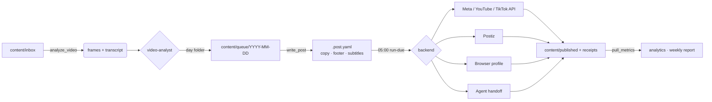

<div align="center">

<picture>
  <source media="(prefers-color-scheme: dark)" srcset="assets/readme/banner-en-dark.svg">
  
</picture>

<br/>

[](https://github.com/robgallardof/social-publisher-mcp/actions/workflows/tests.yml)


**English** · [Español](README.es.md)

</div>

<p align="center">
<a href="#-what-it-does"></a>
<a href="#-works-with-every-agent"></a>
<a href="#-quick-start"></a>
<a href="#-how-a-video-flows"></a>
<a href="#️-mcp-tools-15"></a>
<a href="#-roles-and-skills"></a>
<a href="#-publishing-backends"></a>
<a href="#-layout"></a>
<a href="#-development"></a>
<a href="#️-good-to-know"></a>
</p>

<p align="center"></p>

<a id="-what-it-does"></a>
<p align="center"></p>

| | |
|---|---|
| 📂 **Dated queue** | `content/queue/2026-10-27/*.mp4` goes out on Oct 27. Three videos in the folder = three posts at 05:00. Week folders (`2026-W44/`) are spread over the days for you. |
| 👀 **Watches every video** | 8-frame contact sheet + Spanish/any-language transcript (faster-whisper) → it knows what happens, whether there is speech and whether subtitles are already burned in. |
| ✍️ **Per-platform copy** | Hook, body, CTA, hashtags and keywords tuned for TikTok, Instagram Reels, Facebook Reels and YouTube Shorts, validated against each platform's real limits. |
| 🔁 **Cross-promotion footer** | Every caption ends with `📲 Follow us too:` and your handles on the *other* networks — automatically. |
| 💬 **Subtitles** | Decides none / platform auto-captions / `.srt` / burned-in, and renders burned subtitles styled for vertical video. |
| 🚀 **Publishes any way it can** | Official APIs (Meta, YouTube, TikTok) → Postiz → a Playwright browser profile → handing the task to the agent itself (Claude in Chrome, Playwright MCP, computer use). |
| ⏰ **05:00 every day** | A Windows scheduled task (cron on macOS/Linux) runs the idempotent publisher with retries, wakes the PC and catches up if it was off. |
| 📈 **Learns** | Pulls metrics, finds the best weekdays and top/bottom videos, and writes a weekly report with at most three actions. |

<a id="-works-with-every-agent"></a>
<p align="center"></p>

`social-forge` is a standard **stdio MCP server**. Besides its tools it exposes every **skill as an MCP resource** (`skill://<name>`) and every **role as an MCP prompt**, so any MCP client gets the full playbook — not just the ones that read `.agents/`.

| Client | How |
|---|---|
| Claude Code | `.mcp.json` in the folder, or user-wide via the installer (+ skills/agents linked into `~/.claude`) |
| Codex | `.codex/config.toml` / `~/.codex/config.toml` |
| Antigravity | `.agents/mcp_config.json` / `~/.gemini/antigravity/mcp_config.json` |
| Cursor · VS Code · Gemini CLI · Windsurf · Claude Desktop | generated config files, or the installer |

```powershell
python scripts/install-mcp.py --list         # which clients are installed
python scripts/install-mcp.py --with-skills  # register for your user everywhere (backs up each file as .bak)
python scripts/install-mcp.py --remove       # undo
python scripts/install-mcp.py --workspace ../davinci-agents  # any other workspace with config/mcp.servers.json
```

<a id="-quick-start"></a>
<p align="center"></p>

```powershell
git clone https://github.com/robgallardof/social-publisher-mcp.git
cd social-publisher-mcp
powershell -NoProfile -ExecutionPolicy Bypass -File scripts/bootstrap.ps1        # env, tests, configs, MCP
powershell -NoProfile -ExecutionPolicy Bypass -File scripts/install-schedule.ps1 # daily 05:00 task
```

macOS / Linux: `sh scripts/bootstrap.sh` and the cron line printed at the end. Requires [uv](https://docs.astral.sh/uv/).

**Prefer Docker?** Optional: the image holds only the MCP code and your folder is mounted at run time.

```bash
docker build -t social-forge:local .
docker run --rm -i -v "C:/path/to/social-publisher-mcp:/workspace" social-forge:local     # stdio, for MCP clients
SOCIAL_FORGE_MCP_TOKEN=<32+ chars> docker compose up -d --build --wait social-forge       # HTTP with a token
```

Ports, extras (`analysis`), the CLI service and scheduling `run-due` from the host are in [docs/DOCKER.md](docs/DOCKER.md).

Then talk to your agent:

> *"Process the inbox"* · *"Prepare tomorrow"* · *"Spread week 44, two per day"* · *"Add subtitles to the storytime"* · *"What worked this week?"* · *"Find squirrel trends in Mexico"*

<a id="-how-a-video-flows"></a>
<p align="center"></p>



<a id="️-mcp-tools-15"></a>
<p align="center"></p>

| Tool | |
|---|---|
| `queue_status` | What goes out each day, overdue, missing copy, new videos in the inbox |
| `plan_week` | Spread a week folder over its remaining days |
| `analyze_video` | Frames, transcript, speech yes/no, `.srt` |
| `make_subtitles` | `.srt`, optionally a burned-in copy for review |
| `check_video` | Duration/resolution vs each platform |
| `write_post` · `preview_post` | Save and preview the per-platform copy (footer added automatically) |
| `brand_info` | Handles per network and what's missing |
| `publish_due` · `publish_now` | Publish or pre-schedule (always `dry_run` first) |
| `mark_published` | Close an agent/manual upload |
| `backends_status` | Is every platform ready? |
| `platform_rules` | Limits per platform |
| `pull_metrics` · `insights_report` | Metrics snapshot and summary |

<a id="-roles-and-skills"></a>
<p align="center"></p>

**Roles** (`.agents/agents/`): `community-manager` (lead) · `video-analyst` · `content-strategist` · `copywriter` · `publisher` · `audience-analyst` · `trend-researcher`

**Skills** (`.agents/skills/`): `content-queue` · `video-analysis` · `subtitles` · `platform-copywriting` · `social-publishing` (+ per-network playbooks) · `agent-browser-upload` · `content-strategy` · `audience-analytics` · `trend-research` · `community-engagement`

The lead role **asks before writing** for your handles on every network, @mentions, links, fixed hashtags and subtitle preference.

<a id="-publishing-backends"></a>
<p align="center"></p>

| Backend | Platforms | Public right away? | Schedules by itself? |
|---|---|---|---|
| `meta_api` | Instagram, Facebook | ✅ | Facebook ✅ |
| `youtube_api` | YouTube | after Google's API audit | ✅ `publishAt` |
| `tiktok_api` | TikTok | after TikTok's audit | — |
| `postiz` | all | ✅ | ✅ (PC can be off) |
| `browser` | all | ✅ | — |
| `handoff` | all | the agent does it | — |

Credentials: [`docs/accounts.md`](docs/accounts.md). They live in `secrets/` (git-ignored).

<a id="-layout"></a>
<p align="center"></p>

```
content/inbox/        drop new videos here
content/queue/        YYYY-MM-DD/ (or YYYY-Www/) + <video>.post.yaml
content/published/    archive with receipts      content/library/  raw takes, rendered versions
brand/                voice, audience, hashtags  config/           social.yaml, browser flows, MCP servers
mcp/social-forge/     the MCP + CLI (domain → services → app → server/cli)
Dockerfile, compose.yaml   optional image (stdio or HTTP with a token)
.agents/              portable skills and roles  scripts/          bootstrap, install-mcp, schedule, sync
```

<a id="-development"></a>
<p align="center"></p>

```bash
cd mcp/social-forge && uv run pytest     # 53 tests: no network, real ffmpeg, real MCP over HTTP
python scripts/test_docker.py            # real image: stdio, CLI, HTTP with token, no personal data
python scripts/sync.py                   # after editing .agents/ or config/
git config core.hooksPath .githooks      # strips AI co-author trailers from commit messages
```

Architecture rules and how to add a backend: [`AGENTS.md`](AGENTS.md).

<a id="️-good-to-know"></a>
<p align="center"></p>

- TikTok and YouTube **API** uploads stay private until each platform audits your app — use `browser` or `postiz` meanwhile.
- Instagram's API has no publish time: it posts at 05:00 itself, so the PC must be on (or use Postiz).
- Never double-posts: every upload writes a receipt; retries only touch what failed.
- Currently configured for **Chomi la ardilla** 🐿️ — a new brand only needs `brand/` and `config/social.yaml`.

<div align="center"><sub>Made with care for creators who'd rather film than fiddle with schedulers.</sub></div>

<br/>


