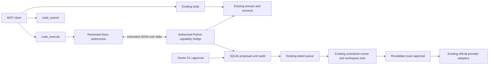

# Self-hosted Code Mode

Code Mode always registers `code_search` and `code_execute` alongside the existing 15 MCP tools.
There is no enable/disable switch or optional Code Mode extra.
Python remains the trusted application; JavaScript runs in a fresh restricted Deno process. No Cloudflare,
hosted sandbox, paid service, internal LLM or replacement scheduler is required.



## Installation and configuration

Install a maintained [Deno 2 release](https://docs.deno.com/runtime/getting_started/installation/).
Deno 2.9.6 was tested on Windows; CI installs that version on Windows, Linux and macOS.
Install Python dependencies, including required psutil, from `mcp/social-forge`:

```sh
uv sync
# Keep other extras you use, for example:
uv sync --extra youtube
```

The `code_mode` section customizes limits; it is not required to activate the tools. Existing configurations
without this section get secure defaults. `deno` accepts an executable name or an absolute executable path;
shell commands and Windows `.cmd` wrappers are rejected. For example:

```yaml
code_mode:
  deno: deno
  principal: workspace-owner
  allowed_platforms: [instagram, youtube]
  timeout_ms: 10000
  cpu_ms: 5000
  memory_mb: 256
  max_output_bytes: 65536
  max_code_bytes: 32768
  max_calls: 32
  max_concurrency: 4
```

An empty `allowed_platforms` uses `default_platforms`; a nonempty list narrows those platforms.
Unsupported keys and out-of-range limits fail configuration validation. There is no approval-bypass option.
The server always registers both tools. Deno 2 and psutil are required for execution; missing dependencies
produce a clear error and never cause an unsafe fallback. Bootstrap requires Deno before proceeding.

All existing clients use ordinary MCP. For Claude Code, Codex, Cursor, Gemini/Antigravity, OpenCode or other
stdio clients, use the existing installer and server registration, without special extras:

```sh
uv run --directory /absolute/path/social-publisher-mcp/mcp/social-forge social-forge-mcp
```

If editing shared startup arguments, edit `config/mcp.servers.json` and run `python scripts/sync.py`;
do not hand-edit generated client files. The existing HTTP transport and bearer guard also work:

```sh
uv run social-forge-mcp --http --listen 127.0.0.1:8080
```

HTTP still requires `SOCIAL_FORGE_MCP_TOKEN` as described in [DOCKER.md](DOCKER.md). The token is never inherited
by the child. Docker remains optional. The standard image includes the official Deno 2.9.6 binary and psutil.
Code Mode works with the default configuration.

## Discovery and execution

MCP tool arguments:

```json
{"name":"code_search","arguments":{"query":"accounts requirements","provider":"youtube","read_only":true,"limit":3}}
```

Search returns a bounded selection with Python-derived input schemas, output contracts, permissions,
side effects, approval requirements, providers, limitations and compact signatures. Operation schemas are generated
from handler annotations/Pydantic models; the small allowlist deliberately excludes unsafe legacy operations.
Search does not run JavaScript or access provider credentials.

```json
{"name":"code_execute","arguments":{"code":"return await social.accounts.list();","read_only":true}}
```

The code is an async JavaScript function body with `social` as its argument. Use `return` for JSON results.
Arguments are named objects, including for operations with one argument. No modules or packages are needed.

```javascript
const accounts = (await social.accounts.list()).accounts;
const results = [];
for (const account of accounts) {
  try {
    results.push(await social.accounts.capabilities({platform: account.platform}));
  } catch (error) {
    results.push({platform: account.platform, error: error.message});
  }
}
return results.filter(result => result.supported);
```

`Promise.all` / `Promise.allSettled` support bounded parallel calls. Batch larger lists in groups of
`max_concurrency`; excess simultaneous calls reject with `concurrency_limit`. The host independently enforces
the limit, even if code forges the stdio protocol. Loops, branching, filtering and error handling are ordinary JS.

| Capability | Behavior |
|---|---|
| `accounts.list({})` | Configured workspace aliases, backend and `authentication: not_checked`; not a live account directory |
| `accounts.capabilities({platform})` | Existing repository rules, configured backend and explicit unsupported features |
| `queue.list({days?})` | Up to 200 dated queue entries, queue-relative identifiers, allowed-platform receipt statuses |
| `media.inspect({video, targets})` | Existing FFmpeg duration/resolution/aspect checks; media bytes stay in Python |
| `posts.preview({video, draft})` | Rendered platform copy, validation problems and unverified requirements; no queue writes |
| `posts.propose({video, draft})` | Immutable pending proposal and review digest in SQLite; no publication |
| `posts.status({proposal_id})` | Approval state plus actual per-platform receipts, stable operation IDs and retry eligibility |
| `schedule.create({proposal_id})` | Activate an exact owner-approved proposal in the existing dated queue |
| `schedule.cancel({proposal_id})` | Cancel future local attempts; cannot recall remote posts or remote schedules |
| `analytics.summary({})` | Cached, platform-filtered CSV summary with source, collection-file time and unavailable metrics |

`draft` contains `caption`, `title`, `hashtags`, `platforms`, `privacy` and `subtitles` (`none` or `burned`).
Automatic-caption switches and SRT uploads are not implemented by this bridge. Provider payloads,
approval booleans, arbitrary account IDs, absolute file paths and unknown fields are rejected. `video` must be
the exact queue-relative identifier, for example `2026-11-03/clip.mp4`, not just a basename. Media outside the
queue, path traversal and escaping symlinks are rejected. Heavy rendering/transcription is intentionally not
exposed; use the existing direct tools and preserve the original media.

## Exact approval and scheduling

With `read_only: false`, code may prepare a local proposal; this flag is **not** publication approval:

```javascript
const args = {
  video: '2026-11-03/clip.mp4',
  draft: {
    caption: 'A short story', title: 'A short story', hashtags: ['story'],
    platforms: ['instagram', 'youtube'], privacy: 'public', subtitles: 'burned'
  }
};
const preview = await social.posts.preview(args);
if (Object.values(preview.copies).some(copy => copy.problems.length)) return preview;
return await social.posts.propose(args);
```

The proposal binds the streamed SHA-256 of the media, rendered content and metadata, target platforms,
configured provider targets, privacy settings, timezone/slot, brand footer, action, workspace identity,
previous sidecar version and all relevant configuration. No recurring authorization is supported.
Credential bindings remain in trusted Python/SQLite, not in JavaScript responses. Replacing Meta/TikTok
credentials invalidates approval conservatively. YouTube binds the stable refresh credential/client ID so
ordinary access-token refresh can proceed without changing the approved account binding. This does not
replace live account ownership verification, which the existing application does not implement.
The original queue is unchanged until activation; previously authorized legacy queue items retain their own plan.

The **owner**, after reviewing the exact preview, runs these commands from `mcp/social-forge`:

```sh
uv run social-forge code-review PROPOSAL_ID
uv run social-forge code-approve PROPOSAL_ID EXACT_DIGEST 604800
```

The last argument is the approval lifetime in seconds (default seven days, maximum 30 days). It must cover
the intended execution time. Approval is persisted, scoped to the configured workspace principal and expires.
Approval issuance is intentionally absent from MCP and JavaScript. An agent must not invoke the owner command
on its own; local shell access under the owner account is outside the sandbox trust boundary.

After approval, the agent can activate it:

```javascript
return await social.schedule.create({proposal_id: 'THE_APPROVED_ID'});
```

Activation validates approval and writes an atomic `.post.yaml` with a protected proposal reference.
Retries of activation are idempotent. A crash after sidecar persistence but before the SQLite status update
does not lose authorization or require replaying JS. JavaScript execution itself is not serialized or resumed;
the durable unit is the immutable proposal/queue entry. Review and approve a new proposal after material changes.

The existing OS scheduled task/cron calls `social-forge run-due`. Default slot remains **05:00
America/Mexico_City**, with existing timezone, catch-up, stagger and `ahead` rules. An ahead-capable provider
may receive its native schedule early; other providers wait for the slot. No in-memory production timer is added.
The runner rechecks the exact approval, media, configuration, permitted targets and existing backend readiness.
Current adapters do not fully introspect live OAuth scopes, account ownership or every provider restriction.

Code Mode proposals require `meta_api`, `youtube_api` or `tiktok_api`. Browser, handoff and Postiz remain
available through the legacy workflow but cannot be activated by Code Mode. Non-YouTube proposals currently
accept public privacy only. Approved TikTok jobs stop before upload if creator privacy options cannot honor
the approved setting. Code Mode does not add providers, post deletion, account OAuth, AI generation or recurrence.

## Failure recovery and audit

All real runner executions share an OS-backed workspace lock across processes, covering scan through archive.
The lock is released on worker death. Receipts are atomically replaced and flushed before provider dispatch
with a stable `operation_id` and `publishing` state. A crashed worker leaves that state for reconciliation.
Successful platforms are skipped on subsequent runs. There is no cross-platform rollback.

An ambiguous exception or lost response records `unknown`, preserving available remote IDs, and blocks retries.
Only `RetrySafePublisherError`, an adapter's explicit assertion of no remote effect, permits automatic retry.
This conservative rule also applies to legacy jobs. Existing attempt limits/catch-up behavior remain in effect;
no general rate-limit/backoff service was added. TikTok polling exhaustion now reports `unknown` rather than
claiming a processing post was published.

After verifying a remote outcome in the provider, the owner can reconcile a Code Mode attempt:

```sh
uv run social-forge code-reconcile PROPOSAL_ID youtube published VERIFIED_REMOTE_ID
# Or, only after verifying that no remote publication exists:
uv run social-forge code-reconcile PROPOSAL_ID tiktok not_published
uv run social-forge code-cancel PROPOSAL_ID
```

Do not mark an uncertain attempt failed based only on a timeout. Reconciliation preserves operation IDs and
does not replay completed targets. `PARTIALLY_PUBLISHED`, `UNKNOWN`, `FAILED`, `SCHEDULED`, `PUBLISHED` and
approval/cancellation states reflect per-platform receipts. Local cancellation cannot undo already-dispatched
remote actions. Automatic remote reconciliation is not implemented; older adapter exceptions often omit IDs.

`content/.code-mode.sqlite` persists proposals, approvals and audit events. Events include time, execution or
proposal correlation ID, workspace identity, known operation, status and duration. Publication remote IDs live
in receipts correlated by proposal/operation ID. Generated source code, provider exceptions, credentials and
caption content are not logged. Audit events expire after 30 days on the next write; proposals remain for
recovery/review until the owner removes the workspace state. Back up SQLite, sidecars and receipts together.
The original CLI log still records runner reports; provider failures now use fixed classifications.

Failures return stable codes such as `capability_denied`, `account_denied`, `invalid_arguments`,
`approval_required_or_expired`, `approval_invalidated`, `official_backend_required`, `output_limit`,
`execution_timeout`, `cpu_limit`, `memory_limit` and `sandbox_failed`. Execution failures include correlation
IDs and admitted call outcomes when available. JS can catch operation errors and return partial results.
For uncaught JS failures the bootstrap uses `javascript_error` rather than echoing arbitrary exception content.

## Security boundary and limitations

* One trusted owner/workspace per server process. HTTP bearer holders share that owner's trust domain;
  this is not a multi-tenant SaaS authorization system. Use separate roots/processes/OS accounts for distinct
  owners. The sandbox cannot select another root, principal, provider account ID or credential store.
* Deno runs with explicit deny-all read/write/network/environment/run/FFI/system/import permissions,
  no config/npm/remote loading, no prompts and a minimal environment. Tokens remain in existing Python services.
  The only permitted communication is bounded stdio with a Python allowlist that revalidates every request.
* Deno is a separate process, not an embedded privileged Python engine or `node:vm`. It is a runtime permission
  sandbox, not a VM or kernel container. A native Deno/V8 vulnerability is outside this boundary. Keep Deno
  patched and use a restricted OS account/container for additional containment in hostile deployments.
* V8 old-space is capped at half the memory budget. Mandatory psutil monitoring samples total process RSS
  and CPU every 10 ms and kills over-budget processes. These are **sampled enforcement limits**, not hard kernel
  address-space quotas: transient allocation/CPU overshoot is possible. This implementation does not claim
  hard OS quotas. Use OS/container quotas if those are a deployment requirement.
* At most two executions per Python process, at most configured concurrent calls per execution, bounded total
  calls, code size, cumulative bridge-response bytes and sandbox-output bytes. No unrestricted debug output.
  Other MCP/runner processes have their own execution quotas; there is no host-global admission service.
* Timeout includes startup plus JS/bridge waiting. Cancellation kills the child and waits for admitted trusted
  host calls to finish; already committed local proposals/schedules remain committed. FFmpeg probing has a
  separate 15-second bound. Host hashing/SQLite/media work can extend cleanup beyond the JS timeout. Media is
  streamed for hashing, not loaded into JS. Local filesystem mutations by the trusted owner are not prevented.
* No insecure fallback: missing Deno/psutil, unsupported flags or sandbox startup failure prevent execution.
  Native Code Mode was executed on Windows; Linux/macOS Code Mode checks are configured in CI but were not
  run as native installations in this session. Linux Docker smoke checks exercise real restricted Deno execution.
* Direct legacy tools retain their existing authorization contract, including `dry_run` defaults and the
  instruction to obtain user approval for real publishing. Code Mode approvals do not retrofit those tools
  into an untrusted multi-user API. Never give untrusted clients unrestricted owner CLI/direct-tool access.
* Media validation reuses implemented duration/resolution/aspect checks. Codec, account-specific file-size
  ceilings, cover/thumbnail support, all privacy combinations, quota and complete live OAuth scope negotiation
  are explicitly unverified. No new claim is made about Shorts classification. Providers can still reject media.
* Analytics uses the existing CSV. Its historical zero-filled fields cannot distinguish missing from measured
  zero; the response warns about that. Watch time/reach/impressions are unavailable, not fabricated. The file
  modification timestamp is identified as a cache timestamp, not a provider reporting-period guarantee.
* Meta's existing upload adapter buffers bytes in the host; this change does not add streaming to that adapter.
  No real account or provider API was exercised for this implementation.

## Validation and benchmarks

From `mcp/social-forge`:

```sh
uv sync
uv run pytest -q
uv run pytest tests/test_code_mode.py -q
uv run --with tiktoken python benchmarks/code_mode.py --deno deno --repeats 5
uv build --wheel
```

From repository root, after changing configuration: `python scripts/sync.py` and
`python scripts/sync.py --check`. For a Deno executable outside PATH set `SOCIAL_FORGE_TEST_DENO` for tests;
the benchmark uses `--deno`. Code Mode tests require Deno and fail if it is missing. CI installs the required runtime.
Tests include real MCP stdio and real restricted JS, forged bridge requests, credential/file/shell/network
denials, permissions, CPU/RSS/output/call/time limits, cancellation, owner approval, tampering, expiry,
restart recovery, cross-process locking, safe retry, reconciliation and partial publication. Workflow C also
uses the actual Meta adapters against fake provider HTTP servers implemented with `httpx.MockTransport`.
All normal tests avoid real provider calls and production publishing.

See [benchmark report](benchmarks/CODE_MODE.md), [raw measured results](benchmarks/code-mode-windows.json)
and [architecture decision](adr/0001-code-mode.md). Measurements do not establish a universal efficiency win.
Production account verification, hard OS quotas and multi-platform runtime measurements remain release-validation work.

Validation record (2026-11-02): 117 tests passed, one optional analysis-extra test skipped; all 62 Code Mode
tests ran with the real Deno runtime. Ruff checks passed for new modules/tests/benchmark. Wheel build passed
and includes `code_worker.js`. Configuration sync/check passed. `python scripts/test_docker.py` passed image,
stdio, CLI and authenticated HTTP checks, including real restricted Deno execution in the standard Linux
image with no Code Mode configuration. Six paired benchmark scenarios matched their expected results.
